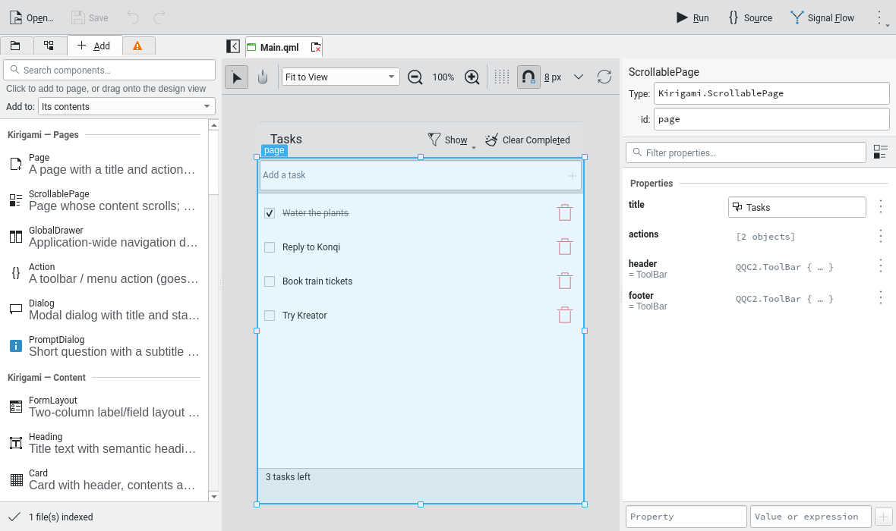

# Kreator

A Glade-style designer for Qt user interfaces. It loads, previews and edits
**Qt Quick / Kirigami (`.qml`)** files and **Qt Designer (`.ui`)** forms. The tool is
itself a Kirigami application, and it checks your UI against the
[KDE Human Interface Guidelines](https://develop.kde.org/hig/).



The screenshot shows `examples/tasks`, an application built in Kreator from
*New Project…*.

- **[User guide](docs/user-guide.md)**: how to use Kreator, task by task.
- **[Developer guide](docs/developer-guide.md)**: how Kreator is built, and how to change it.

This README is the compact reference: every feature, requirements, shortcuts.

Kreator was called QViewer before. On the first start it takes over QViewer's
settings (`~/.config/qviewer/qviewer.conf`) and saved session.

## Features

### Design view

- **Live preview** rendered by the real Qt Quick engine with the Breeze /
  `org.kde.desktop` style.
  - Kirigami pages are shown inside a page stack, so the title and toolbar
    actions look as they will in the app.
  - `ApplicationWindow`s are shown inline at their declared size.
  - `.ui` forms are rendered with `QUiLoader`.
- **Select objects in the preview** or in the **outline tree**. The selection is
  highlighted in both. *Interact* mode lets you use the preview like the real app.
  Preview sizes: phone, tablet, laptop or desktop, plus zoom. Zoom also applies
  to popup and dialog previews.
- **Property inspector**:
  - Each value type has its own editor: switches, numbers, enum drop-downs,
    colour pickers, translatable strings and JS expressions.
  - `i18n()`/`qsTr()` wrappers are kept when you edit text.
  - Runtime values are shown next to bindings (`= 320`).
  - *Show All Properties* lists every property of the live object.
  - Layout and `FormLayout` attached properties are suggested.
  - **Add anything by name:** a property, a signal handler (`onClicked`), an
    object (`footer` = `QQC2.ToolBar {}`), or a declaration: typing
    `property int count` (or `required property string title`) as the name
    declares the property.
- **Component palette** (the *Add* tab):
  - **Contents:** Kirigami pages, cards, messages and forms, Qt Quick Controls
    and layouts, data and logic (`ListModel`, `ListElement`,
    `KSortFilterProxyModel`, `Connections`, `Settings`), or Qt Widgets.
  - **Add to:** a component goes among the selected object's contents, or
    into one of its properties that hold objects: a page's `header` or
    `footer`, a control's `contentItem`, a view's `delegate`, a field's
    `rightActions`… The list shows what the object has, and what is taken.
  - **Defaults follow the HIG:** `Kirigami.Units` spacing, translated text,
    title-case buttons.
  - **Smart placement:**
    - Actions go into `actions: [...]`.
    - `FormLayout` children get a `Kirigami.FormData.label`.
    - `.ui` form layouts get proper rows and columns.
    - Containers get a layout.
    - What is drawn goes on a Kirigami window's page; models, settings and
      dialogs stay with the window.
- **Design grid** in Kirigami units (small spacing, large spacing or grid
  unit). Drag objects, or components from the *Add* tab (with a preview of
  their size), onto the design view, and resize objects by their handles.
  - **Snapping** to the grid, to the edges and centres of neighbouring
    objects (alignment guides), and to equal spacing between objects;
    components dropped into a gap between two objects stretch to fill it with
    equal gaps. Hold Shift to place freely.
  - **Distance indicators** to nearby objects, labelled with the Kirigami
    spacing unit they match (`8 · largeSpacing`), with equal gaps marked;
    resizing and dropping snap to and mark the sizes of other objects.
  - **Positions and sizes in units:** `x: Kirigami.Units.largeSpacing * 6`.
  - **Keyboard:** arrow keys move the selected object to the next grid line
    (optionally also stopping at alignment guides), Ctrl+arrow keys resize it.
  - **Covered objects:** Alt+click selects the object under the selected one;
    a selected object can be dragged even where another covers it.
- **Structure editing**: move up/down, duplicate, cut/copy/paste (as QML/XML text, so
  you can paste snippets from elsewhere) and delete. Renaming an `id` also updates
  references to it.
- **Undo/redo** for every change, per document.
- **Round-trip safe QML editing**: comments, functions, signals, inline
  components and the formatting of untouched code are kept.
  - The parser was tested against the ~1,870 QML files from Qt, KDE
    Frameworks and Plasma on the development machine, and every file it
    parses is written back without semantic changes.
  - Two files with annotations (`@Foo`) before the root object can't be
    parsed.
  - A few comments in unusual places, such as inside a property declaration's
    type, are dropped.

### Source view with Kate's editor

The source view (Ctrl+Shift+E) is Kate's own editor, the KTextEditor framework
from your system, embedded in Kreator. It has highlighting, folding, search and
replace, go to line, word completion, multiple cursors, vi mode, spell checking
and the minimap.

- **A Kate document per tab**, as in Kate: switching tabs keeps each file's
  cursor, scroll position and editor undo history, and the language server
  keeps the file open instead of analysing it again.
- **Updates come with your system.** Kreator links the installed KTextEditor,
  so when Kate's editor (`kf6-ktexteditor`) or its highlighting definitions
  (`kf6-syntax-highlighting`) are updated, Kreator gets the update on its
  next start. Only a move to KDE Frameworks 7 needs a rebuild.
- **Kate's LSP client in the editor.** Kreator loads Kate's own LSP client
  plugin (from the `kate` package) and runs it with Kreator's qmlls. The
  editor gets qmlls' completion, underlined diagnostics with hover, go to
  definition (Ctrl+click), find references (Ctrl+Alt+L), rename (F2), code
  actions (Alt+Return), symbol highlighting and, with Kate's setting on,
  semantic colours, just like Kate. Kate's panels (references, its diagnostics
  list) show up below the editor (*Panels* in the toolbar). Updates of Kate
  reach these features on Kreator's next start.
  - Go to definition in another QML/UI file opens it in Kreator.
  - Go to definition on a type implemented in C++ (`Rectangle`, `Item`,
    `Kirigami.Icon`…), which has no source file, shows a small description
    instead:
    - its module, properties, signals and methods
    - inherited members, collapsed per base type
    - read from the `.qmltypes` files of your Qt/KDE installation and of the
      project's build
  - A rename or code action that changes other files changes them in
    Kreator as unsaved, undoable edits (like the Guidelines tab's quick
    fixes); nothing is written to disk until you save.
  - Kate asks before starting a language server it doesn't know yet; the
    qmlls you configured in Kreator is allowed for Kreator only (Kate's allow
    list stays as it is).
- **Settings are shared with Kate**:
  - Kreator starts with Kate's editor settings (theme, font, indentation, …)
    and its LSP client settings (including
    `~/.config/kate/lspclient/settings.json`).
  - *Configure Editor…* in the source view opens Kate's settings pages for the
    editor and the LSP client, and writes changes back to Kate.
  - Changes made in Kate apply in Kreator from its next start.
  - A few document settings are Kreator's own and not shared. Kreator saves
    its files itself, so Kate's swap files, auto save and auto reload are off
    for the documents Kreator shows.
- **Kreator owns files and the app, Kate owns text editing.** These keys are
  Kreator's in the source view too:
  - Ctrl+S and Ctrl+Shift+S (save)
  - F5 (reload) and Ctrl+Return (apply)
  - Ctrl+Shift+E (design/source), Ctrl+Shift+G (signal flow) and
    Ctrl+Shift+R (run)
  - Ctrl+Shift+O (open in Kate)
  - Ctrl+Alt+P (Kreator's Go to Symbol, instead of Kate's workspace symbol
    search)

  Ctrl+Z and Ctrl+Shift+Z in the source view are Kate's undo.
- **Edits are applied** to the design with *Apply* (Ctrl+Return) or when you
  leave the source view. Unapplied text survives a crash.
- **Symbols:** in the source view the sidebar's *Outline* tab becomes
  *Symbols*: qmlls' outline of the file (objects with their ids, properties,
  functions, signals; property bindings with a toggle). It has a filter,
  follows the cursor, and jumps on click. **Go to Symbol** (Ctrl+Alt+P) is a
  quick picker over the same symbols.
- **One qmlls for Kate and Kreator.** Kate's LSP client and Kreator's own
  features (problem count, symbols, the project's qmllint list) share one
  qmlls:
  - Kate starts a small bridge (`kreator/lspbridge.py`) that connects back to
    Kreator.
  - Where both have a file open, the editor's text is what qmlls sees.
  - Files of different projects (a `.qmlls.ini` or git checkout each) get a
    qmlls each. Up to three stay running, so switching between their tabs
    doesn't restart qmlls or load the types again.
- **The module is built once** from `kreator/native/kateeditor` the first time
  Kreator starts (see [Requirements](#requirements)).
  - Without it, or with *Use Kate's editor* switched off in the settings,
    Kreator uses its built-in source editor (below).
  - Without Kate installed, or with the language server off, the editor works
    without the LSP features.

### Built-in source editor

The fallback when Kate's editor isn't available. It works like Kate:

- **Highlighting** uses Kate's engine and syntax definitions
  (KSyntaxHighlighting).
- **Kate's settings:** it follows your settings in `katerc` (colour theme,
  font, indentation width, tabs or spaces, auto brackets, line numbers) and
  updates live when you change them in Kate. *Configure Kreator…* → *Built-in
  editor: use Kate's colour theme, font and indentation* turns this off, for
  the system colours.
- **Kate-style typing:** auto-indent, indent after `{`, smart `}`, auto-closed
  brackets and quotes, Tab/Shift+Tab to indent a selection, Ctrl+/ to toggle
  comments.
- **Dynamic word wrap** (F10, the toolbar button or the context menu),
  following Kate's setting:
  - Wrapped rows line up with the indentation of the line they continue, up
    to Kate's "align to indentation" limit (80% of the view width by
    default).
  - Line numbers stay on the first row of each wrapped line.
- **Bracket matching:**
  - The bracket next to the cursor and its partner are highlighted in the
    theme's colour.
  - Brackets inside strings and comments are ignored, as in Kate.
  - With Kate's *Animate bracket matching* on (always on without Kate style),
    the matching bracket pops up enlarged and shrinks into place.
- **Code folding:**
  - Fold `{…}`/`[…]` blocks (or XML elements in `.ui` files) with the
    triangles in the gutter. A folded block shows a `... }` badge; click it to
    unfold.
  - Ctrl+- / Ctrl+= (or Ctrl++) fold and unfold the current block, and
    Ctrl+Shift+- / Ctrl+Shift++ the top-level blocks. *Unfold All* is in the
    context menu.
  - Folds stay put when you edit elsewhere, and moving the cursor into folded
    code unfolds it.
- **Search and replace** (Ctrl+F / Ctrl+R):
  - Search is incremental, with all matches highlighted and a "3 of 12"
    counter.
  - Options: match case, whole words, regular expression (`\1` … in the
    replacement).
  - Enter / F3 goes to the next match and Shift+Enter / Shift+F3 to the
    previous one, wrapping around.
  - Replace and Replace All (Ctrl+Return in the replace field; one undo step).
  - Esc closes the bar. Matches inside folded code are unfolded.
- **Go to line** (Ctrl+G): `42`, `42:7` (line:column) or relative `+10` /
  `-10`.
- **Language server** (Qt's `qmlls`):
  - **Completion** after `.` or three letters, or with Ctrl+Space.
  - **Diagnostics** from qmllint: underlines, gutter dots, tooltips, a counter
    in the toolbar, and F8 / Shift+F8 for the next/previous problem. Warnings
    about `i18n()` are dropped (KDE apps get it from `KLocalizedContext` at
    run time).
  - **Go to definition** (F12 or Ctrl+click), also into other files.
  - **Semantic highlighting** by what qmlls says identifiers are, in the Kate
    theme's styles: properties (Attribute), ids and variables (Variable),
    methods (Function), enum values (Constant), types (DataType). Parameters
    are italic, deprecated names struck out. Turning semantic highlighting off
    in the settings brings back KSyntaxHighlighting.
  - **qmllint quick fixes:** Alt+Return or Ctrl+. on a line with a lightbulb.
    *Apply All Safe Fixes* applies every safe fix in one undo step. A `<id>.`
    placeholder is selected so you can type the id.
  - **Find references** (Shift+F12): a panel grouped by file; uses in the
    current file are highlighted.
  - **Rename** (F2). Other affected files are saved right away, after you're
    asked.
  - **Format Document** in the context menu.
  - A project's `.qmlls.ini` is used. Switch the language server off, or set
    its program, under *Configure Kreator…*.
- **Selecting with the mouse** works in any direction. Dragging past the top
  or bottom edge keeps scrolling and selecting.

### Signal flow

**Signal Flow** (Ctrl+Shift+G) shows a graph of what makes what happen, read
left to right.

- **Ports:** each object is a node with ports, the signals, functions and
  properties that take part. An output's connector is on the right, an
  input's on the left.
- **Arrows** run from port to port. In a dialog with
  `onOpened: nameField.forceActiveFocus()`, the dialog's `opened` flows into
  `nameField`'s `forceActiveFocus()`. A function has both sides: who calls it,
  and what its body does.
- **Few crossings:** ports and objects are ordered so that as few arrows as
  possible cross.
- **Red ports** are defined in the file but nothing in the file connects to
  them:
  - a function, a declared signal or a signal handler
  - a declared property whose name appears nowhere else in the file
  - a form's own signal or slot

  They may still be used from another file; the tooltip says so.
- **What it finds.** For a Qt Designer form, the graph shows the form's
  signal/slot connections, which is exact. For QML it reads the code:
  - signal handlers that call, set or read other objects by id
  - `Connections` blocks, with targets outside the file shown as grey boxes
  - `x.signal.connect(f)` calls
  - functions called and signals emitted
  - bindings to other objects' properties (dashed), with anchors, sizes and
    `Layout.*` as a separate *Layout* kind (dotted, off by default)

  The analysis is static: anything that goes through JavaScript variables,
  models or C++ isn't seen.
- **Using it:**
  - **Arrows:** hover an arrow's middle dot for what it does and where; click
    it to open that code.
  - **Ports:** click a port to see where it is written or used. A red port
    that is a declaration (function, signal, property; a form's signal or
    slot) offers *Remove*, undoable. A form's signal or slot can be removed
    only if no widget of its class is connected through it.
  - **Objects:** click an object to select it, double-click it for its code.
  - **Moving:** drag an object's title bar to move it. Moved objects keep
    their places until *Reset Layout*, also across restarts.
  - **Zoom and scroll:** the mouse wheel or a touchpad pinch zooms at the
    pointer (Ctrl with two-finger scrolling too). Two-finger scrolling, or
    dragging the background, scrolls.
  - **Filters:** *Signals*, *Bindings* and *Layout* toggle kinds of arrows.
    *Selected Object Only* narrows the graph to one object; a document with
    more than 150 arrows starts that way (*Show All*).
- **A form's connections can be edited:**
  - Drag from a signal's connector, or a widget's title-bar handle, to another
    widget (dropping on a slot fills that in).
  - *New Connection…* works without dragging, and *All Widgets* also shows
    unconnected widgets.
  - Click an arrow's dot to *Edit*, *Delete* or *Show in Source*.
  - The dialog lists the signals and slots of the widgets' classes, including
    those the form declares and, for custom or KDE widgets, those of the class
    they extend. Only slots that can take the signal's arguments are listed,
    and you can type a signature too.
  - Every change is an unsaved, undoable edit.

### Guidelines

- **KDE HIG checks** of the current document:
  - untranslated strings
  - hard-coded spacing, sizes, colours and font sizes
  - `Text` used instead of `Label`
  - button and action text not in title case
  - form labels without a colon, check box text with one
  - `...` instead of `…`
  - icon-only buttons without text
  - pages without a title, a non-Kirigami `ApplicationWindow`
  - in `.ui` files: style sheets, label buddies, fixed sizes and hard-coded
    layout spacing

  Most issues have a one-click **Fix**, or use **Fix All**.
- **qmllint** view: qmllint's findings for **every file of the project**,
  grouped by file (click a file to collapse it).
  - They come from qmlls, so they match what the source view underlines,
    using the project's `.qmlls.ini`.
  - Filter by text or by errors, warnings and notes; click a finding to open
    its file in the source view at that line.
  - The list fills in while the project is indexed, follows your edits live,
    and is updated when a file changes on disk or is deleted.
  - The tab's count includes these errors and warnings.
- **Quick fixes** from qmllint, right in the list:
  - *Fix* on a finding (its tooltip says what it does), *Fix n* on a file for
    its safe fixes, and *Fix All* for every safe fix in the project.
  - Fixes become **unsaved changes**. A file that isn't open opens as a
    background tab, so you can review a fix, undo it there, and save with
    *Save All* (Ctrl+L). Nothing is written to disk on its own.
  - Fixes that need you to pick an id show *Fix…*, which opens the spot in
    the source view.
  - A fix is only applied to the exact text it was made for.

### Projects and tabs

- **New Project…** (welcome screen, *Files* tab or ☰ menu) asks for a name
  and a folder, creates the folder with a first file and opens it in the
  design view, ready to add components:
  - a **Kirigami application** (`Main.qml`: a window with a page), a **Qt
    Quick application** or a **Qt Widgets form**
  - The QML ones run as they are, with **Run** (or `qml6 Main.qml`). Their
    texts use `qsTr()`, which works there (`i18n()` needs an application that
    sets it up).
  - `examples/tasks` is such a project: the to-do app of the
    [Kirigami Design Guide's tutorial](https://n4n0gh.github.io/Doku/tutorial/overview/),
    built in Kreator (see the
    [walkthrough](docs/user-guide.md#12-walkthrough-a-to-do-app-from-an-empty-project)).
- **One tabbed sidebar** saves screen space. Its tabs:
  - the folder's *Files*
  - the document's *Outline* (*Symbols* in the source view)
  - *Add* (components)
  - *Guidelines*

  When it's narrow, tabs show only their icon. Show or hide it with the toggle
  at the start of the tab bar or F9; the tab and visibility are remembered.
- The dividers between panes only take clicks on their own side, so the
  scrollbar right next to a divider can always be grabbed.
- **Open Folder…** shows the folder's `.qml` and `.ui` files in the *Files*
  tab.
  - Hidden folders and build output such as `build/` or `target/` are left
    out, and the tree follows files being added or removed.
  - Click a file to switch to it. Every document keeps its unsaved changes,
    undo history and selection while you work on another, and modified files
    are marked with a dot.
  - You're only asked about unsaved work when closing the folder, or when
    quitting if the session doesn't keep it (*Save All*, *Discard* or
    *Cancel*).
  - Without a folder open, the tab offers *Open Folder…* and the recent
    folders, as does the welcome screen. *Close Folder* is in the ☰ menu.
- **Run** (Ctrl+Shift+R, in the toolbar) starts the application as one of its
  own, outside Kreator, with Qt's `qml6`:
  - It runs the project's `Main.qml` (or `main.qml`) while one of the
    project's files is shown, else the shown QML file.
  - Unsaved changes to the application's files are saved first. While it
    runs, the button is **Stop**; quitting Kreator ends it too.
  - What it prints (`console.log()`, QML warnings and errors) is collected in
    *Run Output…* (☰ menu). The first error of a run and an application that
    ends with an error are reported, with *Show Output*.
- **Tabs** for the open documents, as in Kate:
  - Unsaved tabs show a dot, which turns into a close button on hover.
    Middle-click or Ctrl+W closes a tab.
  - Drag tabs to reorder them. Ctrl+Tab / Ctrl+Shift+Tab (or Ctrl+PgDown /
    Ctrl+PgUp) cycle through them.
  - When they don't fit, the bar scrolls with the wheel or the ◀ ▶ buttons,
    and a list button shows all documents. The current tab is always scrolled
    into view, and dragging a tab to an edge scrolls the bar.
- **Indexing in the background:** qmlls fetches the symbols and qmllint
  findings of every `.qml` file in the folder (and the open tabs), then loads
  the imported modules' types.
  - Symbols appear as soon as you switch to the source view, and the first
    completion is quick.
  - Progress shows at the bottom of the sidebar.
  - The file you're looking at is indexed first, and files changed by other
    programs are indexed again.
- **Quick Open** (Ctrl+Alt+O, as in Kate): open documents first, then the
  project's files, then recent files, with fuzzy matching. The previously used
  document is listed first, so Ctrl+Alt+O then Enter switches back.
- **Save All** (Ctrl+L). The design or source view stays as it is when you
  switch files.
- **Files changed on disk** while open are reloaded (undoably) when you have
  no unsaved changes there. With unsaved changes, a banner offers *Load Their
  Version* or *Keep Mine*. Files changed while in a background tab are
  checked when you come back to them.

### Sessions

On start, the folder and tabs from last time are reopened, with the same order
and current document. The session includes **unsaved changes, untitled
documents and undo history**, so quitting doesn't ask to save and Ctrl+Z still
goes back past the restart.

- History is stored as small line diffs. It is dropped, rather than
  misapplied, for a file that was changed on disk while Kreator was closed;
  that change is reported when its tab is shown.
- Source view edits that were never applied (even ones that don't parse yet)
  come back too, and so do the places of objects moved in the signal flow
  view.
- Only the current document is loaded into the preview right away.
- The session is saved every 15 seconds (when something changed) and on quit,
  so a crash loses at most that much. Set the interval, or *Only on quit*,
  under *Configure Kreator…* → *Save session every*.
- It's kept in `~/.local/share/kreator/session.json`. Only the first running
  Kreator uses it; a second window started meanwhile neither restores nor
  overwrites it (and asks about unsaved changes on quit).
- Opening a file from the command line (or `--new`) adds it to the restored
  session.
- Under *Configure Kreator…* → *On start*, turn off *Keep unsaved changes, new
  documents and undo history* to be asked about unsaved changes on quit
  again, or turn restoring off entirely.

### External editors

- **Open in Kate** (Ctrl+Shift+O, the button in the source view, or *Show in
  Kate* in the outline's menu) opens the file at the selected object's line
  and column. Kate is found automatically, also as a Flatpak.
- **Kate options:** open in a chosen Kate session, always use a new window,
  and whether to jump to the object.
- **Any other editor** (Zed, VS Code, VSCodium, Sublime, Neovim, Emacs …) can
  be added in *Configure Kreator…*:
  - Give the program path and an argument template with `{file}`, `{line}`,
    `{column}` and `{dir}`.
  - Templates are offered.
  - *Open With* lists all configured editors.
- **Saving and reloading:**
  - Unsaved changes are saved before the editor starts.
  - When the file is saved in the editor, Kreator reloads it and keeps your
    selection, and you can undo the reload.
  - If you also have unsaved changes in Kreator, a banner lets you choose
    *Load Their Version* or *Keep Mine*.

## Requirements

- Python ≥ 3.10
- PySide6 **from your distribution**. It must be built against the same Qt as
  Kirigami. On openSUSE this is `python3-pyside6`, on Fedora `python3-pyside6`, on
  Arch `pyside6`.
- KDE Frameworks 6: Kirigami and `qqc2-desktop-style`. Breeze icons are recommended.
- recommended: `qmlls` (Qt's QML language server, e.g. `qt6-declarative-tools`)
  for completion, diagnostics, symbols and the qmllint list, and `qml6` (the
  same package) for *Run*
- recommended: **Kate** (`kate`) and, to build Kate's editor into Kreator on the
  first start, `kf6-ktexteditor-devel qt6-declarative-devel cmake gcc-c++`.
  Without them Kreator uses its built-in source editor.

## Running

```sh
./kreator.sh                         # welcome screen
./kreator.sh examples/SettingsPage.qml
./kreator.sh examples/dialog.ui
./kreator.sh examples/tasks/Main.qml  # a whole application, built in Kreator
./kreator.sh --new kirigami-app      # kirigami-app | kirigami-page | qtquick | widgets-form
./kreator.sh -I ~/src/myapp/qml Main.qml   # extra QML import path
```

To install it, run `pip install --user --no-deps .` and then copy
`kreator.desktop` to `~/.local/share/applications/`.

## Releases

Releases are on [GitHub](https://github.com/n4n0GH/Kreator/releases); what
changed is in the [changelog](CHANGELOG.md). The tags and the source tarballs
are signed with the key in [`docs/signing-key.asc`](docs/signing-key.asc)
(fingerprint `33DF 82C4 E8B1 F312 C294  ECD1 664E 00DD 1520 1C7C`). To check
a download:

```sh
gpg --import docs/signing-key.asc
gpg --verify kreator-0.1.0.tar.gz.asc kreator-0.1.0.tar.gz
sha256sum -c kreator-0.1.0.tar.gz.sha256
```

## Keyboard shortcuts

**Everywhere**

| Action | Shortcut |
|---|---|
| Open / Save / Save As | Ctrl+O / Ctrl+S / Ctrl+Shift+S |
| Save All | Ctrl+L |
| Reload / Close tab / Quit | F5 / Ctrl+W / Ctrl+Q |
| Toggle design / source | Ctrl+Shift+E |
| Signal flow | Ctrl+Shift+G |
| Run / stop the application | Ctrl+Shift+R |
| Quick Open (files) / Go to Symbol | Ctrl+Alt+O / Ctrl+Alt+P |
| Next / previous tab | Ctrl+Tab / Ctrl+Shift+Tab (or Ctrl+PgDown / Ctrl+PgUp) |
| Show / hide the sidebar | F9 |
| Open in Kate / default external editor | Ctrl+Shift+O |
| Configure Kreator | Ctrl+Shift+, (the Plasma default for Preferences) |

**Design view**

| Action | Shortcut |
|---|---|
| Undo / Redo | Ctrl+Z / Ctrl+Shift+Z |
| Delete / Duplicate | Del / Ctrl+D |
| Cut / Copy / Paste object | Ctrl+X / Ctrl+C / Ctrl+V |
| Move object up / down | Alt+Up / Alt+Down |
| Move object to the next grid line / by a pixel | Arrow keys / Shift+Arrow keys (design view focused) |
| Resize object to the next grid line / by a pixel | Ctrl+Arrow keys / Ctrl+Shift+Arrow keys (design view focused) |
| Place or resize without snapping | Shift while dragging |
| Zoom preview | Ctrl+Wheel |

**Source view with Kate's editor**: Kate's shortcuts (as set in Kate), for
example:

| Action | Shortcut |
|---|---|
| Apply source edits | Ctrl+Return |
| Undo / Redo (the editor's) | Ctrl+Z / Ctrl+Shift+Z |
| Find / replace / go to line | Ctrl+F / Ctrl+R / Ctrl+G |
| Next / previous match | F3 / Shift+F3 |
| Complete | Ctrl+Space |
| Toggle comment / comment / uncomment | Ctrl+/ / Ctrl+D / Ctrl+Shift+D |
| Go to definition | Ctrl+click |
| Find references / rename | Ctrl+Alt+L / F2 |
| Code action (quick fix) | Alt+Return |

**Built-in source editor**

| Action | Shortcut |
|---|---|
| Apply source edits | Ctrl+Return |
| Toggle comment | Ctrl+/ |
| Dynamic word wrap | F10 |
| Find / replace / go to line | Ctrl+F / Ctrl+R / Ctrl+G |
| Next / previous match | F3 / Shift+F3 (Enter / Shift+Enter in the field) |
| Complete / next problem / go to definition | Ctrl+Space / F8 / F12 |
| Find references / rename symbol | Shift+F12 / F2 |
| Quick fix | Alt+Return or Ctrl+. |
| Fold / unfold current block | Ctrl+- / Ctrl+= |
| Fold / unfold top-level blocks | Ctrl+Shift+- / Ctrl+Shift++ |

## Tests

```sh
QT_QPA_PLATFORM=offscreen python3 -m unittest discover -s tests   # document model, editing, checks, signal flow
python3 tests/test_qml_roundtrip.py                                # parse/serialise every QML file on the system
tests/gui/run.py                                                   # GUI tests: drive a real Kreator (-j 3: about 3 minutes)
```

See the [developer guide](docs/developer-guide.md#testing) for trying UI
changes without touching your desktop session.

## Notes and limitations

- The preview runs inside Kreator's own process, so the application's C++ types,
  context properties and singletons are not available. Errors and warnings show up
  above the preview, with line numbers that match the source view. Bindings that
  the preview's type doesn't know about are left out of the preview, and a notice
  lists them.
- **App-internal QML modules** are simulated. This covers modules compiled into an
  executable, such as cxx-qt's `new_qml_module` or a static `qt_add_qml_module`,
  which can't be imported from outside the app. Kreator looks for the module's
  build `qmldir` near the file, for example under `target/` or `build/`.
  - It uses your source `.qml` files, so you see current edits.
  - C++/Rust types listed in the build's `plugin.qmltypes` get placeholder
    objects with the same properties, signals and methods.
  - Without any build output, the `.qml` files in the document's folder are used
    as the module.
  - A file that is part of such a module needs no import for this: Kreator
    finds the module by the build `qmldir` that lists the file, so the module's
    C++ singletons (an application's `Backend`, say) have placeholders too.
- A few bindings that crash Qt when they are `null` outside the app, such as
  `WebEngineView.profile`, are left out of the preview.
- `i18n()` and friends are provided by a small stand-in, so KDE apps preview
  without `KLocalizedContext`.
- Plasma applets need a running Plasma shell. Edit them here, and test them with
  `plasmoidviewer`.
- Saving re-formats the edited QML with 4-space indentation. `.ui` files are
  written in Designer's 1-space XML style.
- Kate's editor is a QtWidgets component shown as a native child window over
  the Kirigami window, so it is always drawn on top. While a QML menu or
  dialog overlaps it, a snapshot is shown in its place.
- PySide6 6.12 bugs that Kreator works around, documented in the code:
  - QML plugins are pre-loaded on the main thread to avoid a GIL deadlock.
  - `qmlRegisterSingletonInstance` is not used.
  - Slots never return a `None` `QObject*`.
